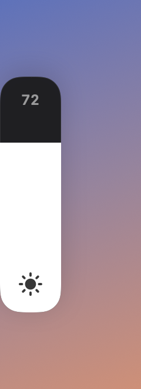
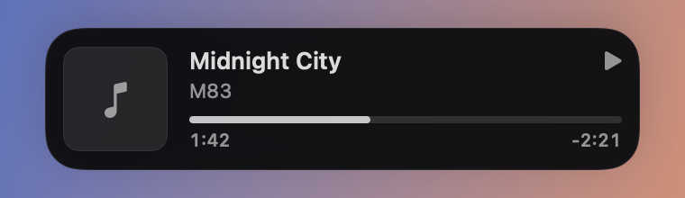
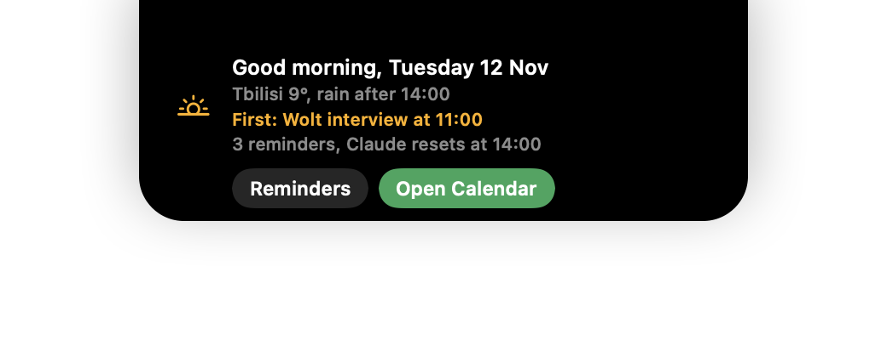
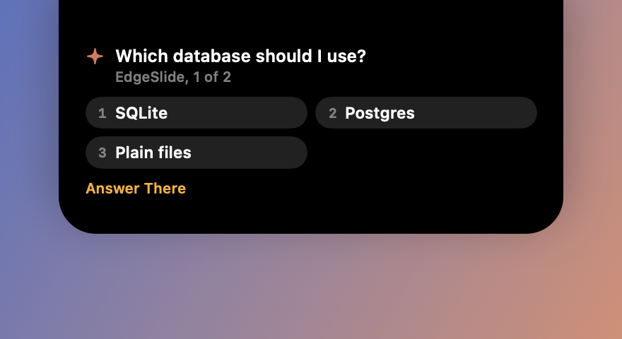
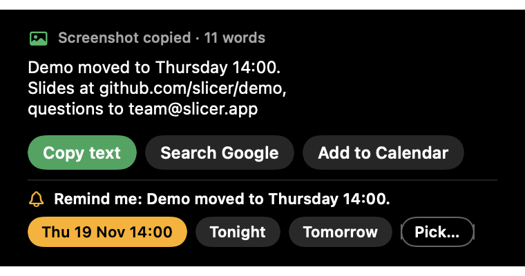

# Slicer

Slicer turns the edges of your Mac's trackpad into sliders. Slide along the left edge for brightness and the right edge for volume. Under the notch, a small island shows what's playing, your next meeting, login codes, Claude Code's questions and more.

 

## Download

1. Download **Slicer.zip** from [Releases](../../releases/latest) and unzip it.
2. Move **Slicer** to your Applications folder.
3. Open Slicer. Because it isn't notarized by Apple yet, macOS stops it the first time. Go to System Settings → Privacy & Security, scroll down and click **Open Anyway** next to Slicer. (On macOS 14 you can instead right-click Slicer and choose **Open**.)
4. Slicer asks for **Accessibility**, so it can read the trackpad and move windows. Turn it on in System Settings → Privacy & Security → Accessibility.

Needs macOS 14 or later and a Mac with a trackpad.

## What it does

- **Edges:** brightness on the left, volume on the right, scrolling in reading apps.
- **Corners and gestures:** tap a corner to mute, multi-finger taps for a window menu, an app shelf along the top edge.
- **The island:** Now Playing, next meeting, battery, downloads, internet drops, prices in lari, dollars and euros.
- **Claude Code:** your usage limits, and Allow, Deny or answer Claude's questions from the island.
- **Your day:** a morning card, eye breaks, an end-of-day wrap-up and where your time went.
- **Screenshots:** take one with three fingers to copy its text, search Google, or pick a date to get a reminder with the picture inside.

 

For the picture inside reminders, Slicer offers to add its "Slicer Reminder" shortcut the first time (Settings → Gestures → Screenshot Text).

Every feature can be switched off in Settings. Your settings and counts stay on your Mac; Slicer only goes online for exchange rates, the weather and your Claude usage.
